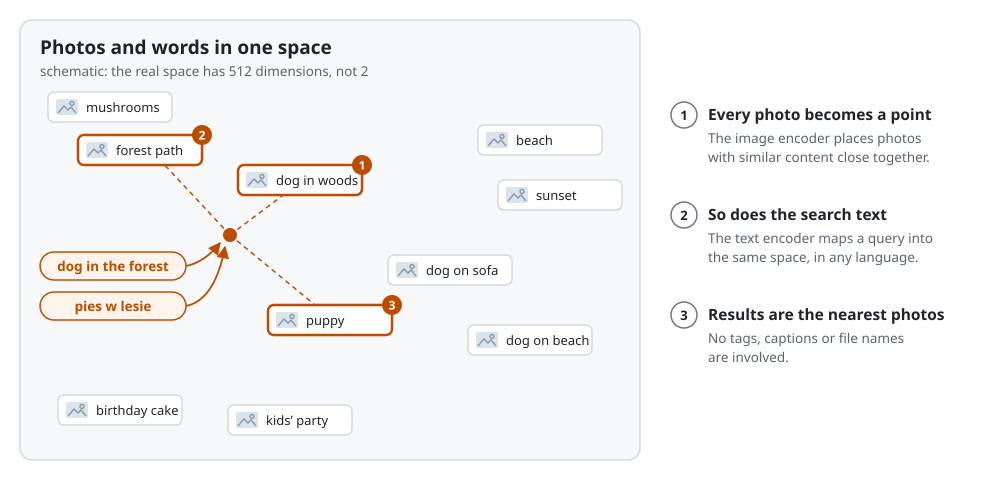
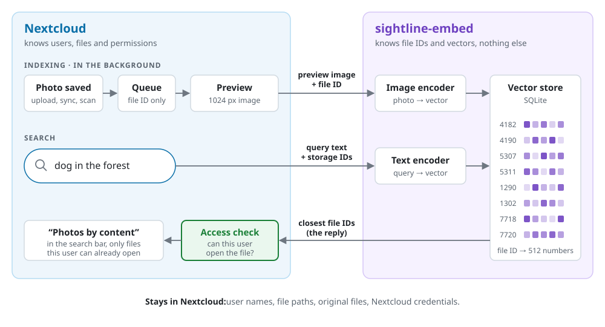
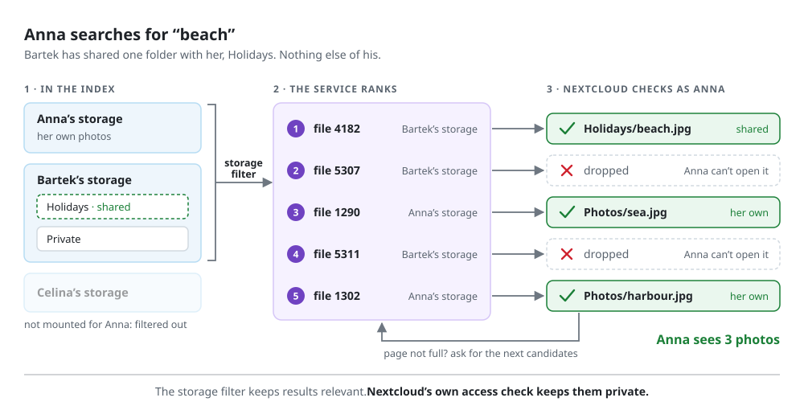

# Sightline

Semantic photo search for Nextcloud. Type "dog in the forest" or "pies w lesie" into the
Nextcloud search bar and get matching photos, ranked by what they show. Everything is
computed on your own server: no cloud service, and no second photo library next to
Nextcloud.

Status: early. It works end to end in a development setup on Nextcloud 33; it is not in the
Nextcloud app store yet.

## How it works



Sightline is two components:

- `app/`: a Nextcloud app (`sightline`) that watches file changes, sends preview images to
  the embedding service, and adds a "Photos by content" section to Unified Search.
- `embed/`: `sightline-embed`, a small Python service that turns images and search text into
  vectors with a CLIP-family model (ONNX Runtime, CPU) and stores them in SQLite.



The service knows only file IDs and vectors. Nextcloud checks every search result against
the searching user's own permissions before showing it, so a user only ever sees photos they
can already open. [docs/architecture.md](docs/architecture.md) explains the design.



## Requirements

- Nextcloud 33 to 35, with system cron for background jobs.
- Previews enabled for the formats you want indexed. HEIC needs Imagick with HEIC support or
  Imaginary. RAW files are not indexed yet.
- A machine on the same network for `sightline-embed`: Docker or Python 3.12. With the
  default XLM-R B/32 model on an Intel N305, measured separately, indexing peaked at 1.1 GB
  of memory and the query side (text encoder only) at 2.2 GB.


## Install

1. Start the embedding service. Generate a token and keep it for step 3, then run the image
   built from `embed/`. Replace `10.0.0.5` with the server's address on your internal
   network:

   ```sh
   TOKEN=$(openssl rand -hex 32); echo "$TOKEN"
   docker build -t sightline-embed embed/
   docker run -d --name sightline-embed -p 10.0.0.5:8765:8765 -v sightline-embed:/data \
     -e SIGHTLINE_TOKEN="$TOKEN" \
     -e SIGHTLINE_MODEL=immich-app/XLM-Roberta-Base-ViT-B-32__laion5b_s13b_b90k \
     sightline-embed
   ```

   The model is downloaded on first start. Do not publish the port to the internet:
   embeddings reveal a lot about photos. See [embed/README.md](embed/README.md) for the
   options.

2. Install the app. Copy the `app/` folder to Nextcloud's `custom_apps/sightline`, then:

   ```sh
   occ app:enable sightline
   ```

3. In Administration settings → Sightline, enter the service URL and token. The page shows
   whether the service is reachable and how far indexing has got. The first crawl starts with
   the next background job run.

## Models

The service runs one model at a time, chosen with `SIGHTLINE_MODEL`. Changing it re-encodes
the library in the background. Both models below accept queries in any language, including
Polish:

| Model | Licence | Vector size | Notes |
|---|---|---|---|
| `immich-app/XLM-Roberta-Base-ViT-B-32__laion5b_s13b_b90k` | MIT | 512 | recommended; best for Polish queries, 50 ms per photo on an Intel N305 (8 threads) |
| `immich-app/ViT-B-16-SigLIP2__webli` | Apache-2.0 | 768 | slightly better for English on family photos, 3.75× the encoding cost |

Measurements are in [docs/measurements](docs/measurements/): 678 stock photos on a MacBook
Air M4, and 400 photos from a family library on an Intel N305 home server, judged blind by
their owner.

## Commands

| Command | |
|---|---|
| `occ sightline:status` | service health and indexing progress |
| `occ sightline:reconcile [--background]` | find new, changed, moved and deleted photos now |
| `occ sightline:index [--limit N]` | process the queue in the foreground, with timings |
| `occ sightline:search <user> <query>` | search as a user, with the same permission checks |

## Related projects

- [Recognize](https://github.com/nextcloud/recognize) recognizes faces and tags objects and
  landscapes in photos.
- [Memories](https://github.com/pulsejet/memories) is a photo gallery for Nextcloud. Since
  v10.0 (October 2026) it ships code for Lens, an optional natural-language search service;
  as of v10.2 it is off by default, undocumented, and its service is built from the Git
  repository. Lens searches the folders of a user's Memories timeline from the Memories
  search bar and fetches original files through a Nextcloud service account.
  Sightline searches every photo a user can open, from the Nextcloud search bar; its service
  receives preview images and holds no Nextcloud credentials.
- [Immich](https://immich.app) is a self-hosted photo library with its own smart search.
  Nextcloud files reach it only as an external library, which belongs to a single Immich
  user and is indexed by path.
- [Context Chat](https://github.com/nextcloud/context_chat) answers questions about
  documents; using CLIP for images is under discussion there
  ([issue #233](https://github.com/nextcloud/context_chat/issues/233)).
- Media Embedding Connector and Glimpse add image search to Nextcloud with different
  designs: the first uses Elasticsearch and its own interface, the second sits on top of a
  full Immich installation and indexes by path.

## Development

`dev/compose.yaml` runs Nextcloud 33 and Postgres with `app/` mounted; `embed/README.md`
shows how to run the service next to it.

```sh
cd app && composer install && composer test
cd embed && uv run pytest
```

## Licence

AGPL-3.0-or-later, see [LICENSE](LICENSE).
