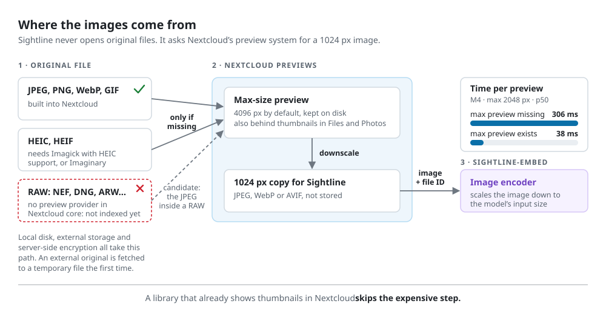

# Architecture

Sightline has two parts with deliberately different knowledge:

- `sightline` is a Nextcloud app (PHP). It knows users, files and permissions. It listens to
  file events, generates preview images, sends them to the embedding service and answers
  Unified Search queries.
- `sightline-embed` is a Python service. It holds an image and text encoder and a vector
  store. It knows file IDs, storage IDs and vectors. It has no Nextcloud credentials, no
  file access and no notion of users.

```
Nextcloud app (PHP)                                 sightline-embed (Python)
──────────────────────────────────────              ────────────────────────
file + cache events ─► queue ─► preview 1024px ──►  PUT /files/{fileid}?storage_id=N
daily crawl + sweep ─┘                              image encoder → vector → sqlite-vec
Unified Search provider ─► POST /search ────────►  {query, storage_ids, offset, limit}
                         ◄── [{fileid, score}] ◄──  text encoder → exact scan within storage_ids
       │
       └─► userFolder->getFirstNodeById(fileid)   ← the permission check
```

Nextcloud pushes images to the service; the service never calls Nextcloud.

## Identity: the file ID

Every vector is keyed by the Nextcloud file ID, never by a path. Paths differ per user
(shares, group folders, external storage) and change on rename. A shared photo has one file
ID, so it is encoded once and found by every user who can see it, under their own path.

The file ID also survives the cases that would break a path-based index. In Nextcloud 33,
measured in the development environment:

| Action | What Sightline sees | Result |
|---|---|---|
| Rename or move within a storage | same file ID, same storage | nothing to do |
| Move to another storage (e.g. external storage) | same file ID, new storage ID | `PATCH` of the storage ID, no re-encode |
| Move to trash | `NodeDeletedEvent`, file kept under `files_trashbin/` | vector deleted |
| Restore from trash | `NodeRestoredEvent`, same file ID | encoded again |

## Permissions

The service returns candidates ranked by similarity. The app keeps a candidate only if
`getFirstNodeById()` on the searching user's own folder returns it. That call applies
Nextcloud's normal rules: ownership, shares, share permissions, trash. Search results
therefore never depend on the embedding service being correct about who may see what.

To keep results relevant, the app restricts the service's scan to the storages mounted for
the user (`IUserMountCache::getMountsForUser()`). This filter is coarse: a share mount
reports the owner's storage, so a user with one shared folder admits the owner's whole home
storage. The provider therefore pages through the ranking until it has a full page of
visible results, for at most five round trips per page. The search cursor is an offset into
the service's ranking, not into the filtered list, so the next page continues exactly where
the previous one stopped reading.

## Indexing

File event listeners only write `(file ID, storage ID, action)` into a queue table. They
never generate previews, so uploads do not slow down. Two event families are needed:

- `Node*` events fire for changes made through Nextcloud (web, WebDAV, apps).
- `CacheEntry*` events fire for changes found by a scan, such as `occ files:scan` or
  `files_external:scan`. They carry no mimetype, and every parent folder of a changed file
  gets one, so the listener filters them by file extension and skips trash, versions and
  app data.

A background job drains the queue every five minutes for up to four minutes (15 seconds when
Nextcloud runs background jobs in AJAX or webcron mode), around the clock: it is
time-sensitive, so a `maintenance_window_start` in `config.php` does not hold it back. For
each file it:

1. resolves the file ID; files outside a user's `files/` folder lose their vector;
2. skips the file if its etag and model match the bookkeeping row;
3. requests a 1024 px preview from `IPreview` with `cacheResult: false`, so only Nextcloud's
   own maximum-size preview is stored, not an extra 1024 px copy;
4. sends the image to the service and records the etag and the model ID.



Images come from `IPreview` because it works the same for local storage, external storage
and server-side encryption, and because the service must not read files. Preview generation
dominates the cost of a first index when no previews exist yet (see
[the skeleton measurements](measurements/2026-10-24-skeleton-nc33-m4.md)). On an instance
that already shows thumbnails in Files or Photos, the large preview exists and indexing only
pays for a downscale and the encoder.

A file the service rejects (an undecodable image) or that has no preview is marked failed
and retried only when its etag changes. When the service is unreachable, the run stops and
the queue stays as it is.

## Reconciliation

Events can be missed: an app disabled during an upload, a crash, a storage that was never
scanned. A daily job compares the file cache with the bookkeeping table in two passes, both
database-only, in pages of 1000 file IDs that resume from a cursor:

- the crawl walks every user-files mount (`IFileAccess::getDistinctMounts()` and
  `getByAncestorInStorage()`) and queues photos that are new, changed or indexed with
  another model;
- the sweep walks the bookkeeping table (`IFileAccess::getByFileIds()`) and queues rows whose
  file is gone, trashed or on another storage.

The admin page and `occ sightline:reconcile` can start the same passes on demand.

## Models

The service is model-agnostic: any CLIP-family image and text encoder in Immich's ONNX
export layout works. Each vector is stored with its model ID, in one table per model. When
the service is restarted with another model, the app notices the new model ID (on the next
health check or indexed file), and reconciliation queues every photo for re-encoding. Until
that finishes, search covers only the photos already re-encoded. Deleting a file removes its
vector from every model's table.

Measured model comparisons are in [docs/measurements](measurements/).

## Transport

The app calls the service over plain HTTP with a shared bearer token. Nextcloud's AppAPI
was considered and not used:

- an ExApp cannot register a Unified Search provider, so a PHP app is needed anyway;
- the AppAPI secret lets its holder act as any user, while the service holding personal
  data should hold no Nextcloud credential at all;
- AppAPI-deployed containers get no access to an Intel iGPU for OpenVINO.

## Vector store

Vectors live in SQLite with the [sqlite-vec](https://github.com/asg017/sqlite-vec)
extension (pinned to 0.1.9), searched by exact brute-force scan. Exact search keeps the
storage filter exact too: there is no approximate-search recall loss inside the set of
storages a user can see. The store sits behind a small interface (upsert, move, delete,
search) so it can be replaced if it becomes too slow at large library sizes.

On the Intel N305 with 122,972 vectors of 512 dimensions, a search takes 223 ms p50 in the
service (94 ms to encode the query, 126 ms to scan) and about 0.36 s in Nextcloud for 50
results. The storage filter barely shortens the scan, because sqlite-vec reads the whole
table ([measurements](measurements/2026-10-28-production-n305.md)).

## Limits

- Nextcloud core has no RAW preview provider. With the Camera RAW Previews app
  (`camerarawpreviews` 1.1.4) RAW files index like any other photo, and portrait RAWs come
  out upright because the app applies the orientation from the RAW file. On a library with
  about 40,000 NEF, DNG and ARW files, 19 failed: 11 on stale preview records, 7 empty or
  damaged files, one unexplained
  ([measurements](measurements/2026-10-28-production-n305.md)). Without the app, RAW files
  end up as failed.
- macOS resource-fork files (`._*` and anything under `.AppleDouble/`) are skipped.
- HEIC needs a preview provider: Imagick built with HEIC support, or Imaginary.
- End-to-end encrypted files are never indexed.
- External storage changes are noticed only after Nextcloud scans that storage.
- Group folders have not been tested yet.
- First indexing is slow where no previews exist yet. One indexing job runs at a time; on an
  Intel N305 with Nextcloud 35 and Imaginary it indexed 7,728 photos in 70 minutes
  (0.54 s per photo), mostly spent generating previews.
- First indexing loads the server during the day as well: on the N305 Imaginary used about
  one core and `sightline-embed` about three. Search while indexing runs has not been
  measured.
- Changing the model re-encodes every photo, and search covers only the re-encoded ones
  until that finishes (see [Models](#models)).
- sqlite-vec reclaims the space of deleted vectors only when a whole chunk of about 1,024
  vectors is empty, so the database file does not shrink after deletions.
